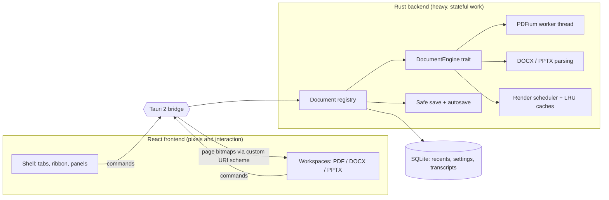

<div align="center">



<br/>


<br/>

### Read better. Sync with the lecture. Keep every file safe.

**[Overview](#overview) · [Features](#features) · [Modes](#modes) · [Architecture](#architecture) · [Roadmap](#roadmap) · [Quick start](#quick-start) · [Contributing](#contributing)**

</div>


## Overview

**B.read** (read it as *better read*) is a fast, native-feeling desktop workspace for documents.

Open a PDF and it scrolls smoothly. Search it in English and Bangla. Highlight it. Then place it beside a lecture transcript where every line is linked to a page, so selecting a moment in the lecture takes you straight to the page being discussed. DOCX and PPTX files open in the same tabbed window.

> [!NOTE]
> B.read is in early development. This README describes what is being built and in what order. The [roadmap](#roadmap) is the source of truth for what works today.


## Features

| Feature | What it means |
|---|---|
| **PDF-first reading** | Virtualized scrolling, zoom, thumbnails and text selection, rendered by PDFium. Designed so a 500-page PDF stays smooth. |
| **Bangla and English search** | Full-text search across the document. Bangla is tested from the first reader milestone, not added at the end. |
| **Safe annotations** | Highlights and notes are saved through a safe-save pipeline: write to a temp file, verify, atomically replace, keep a backup. |
| **Read & Subtext** | Manual transcripts with page links and notes. Select a transcript entry and the page jumps. |
| **Edit / Overlay** | Move, resize and rotate objects on top of a PDF. The original stays untouched until you flatten to a new file. |
| **Tabbed workspace** | One window, one tab per document, and a ribbon that changes with the document type. |
| **DOCX and PPTX viewing** | Open typical Office files in the same workspace, with a clear fidelity disclaimer. |
| **PDF to PPTX export** | Each page becomes a slide background with your overlay shapes on top. |
| **Low memory footprint** | Uses the system WebView instead of bundling a browser, and keeps rendered pages in bounded LRU caches. |


## Modes

| Mode | For | You get |
|---|---|---|
| **Read** | Reading quickly | Smooth scroll, zoom, thumbnails, search, text selection, highlights |
| **Read & Subtext** | Studying with a lecture | Transcript panel, page-linked entries, notes, click-to-jump |
| **Edit / Overlay** | Marking up and building on a PDF | Text boxes, shapes and images as movable overlay objects, with undo and flatten-to-PDF export |

The ribbon is data-driven: each document type declares its tabs and commands, and a command is enabled only when a real handler exists.


## Architecture

One rule splits the system:

> **Rust owns the heavy, stateful work. React owns pixels and interaction.**



- **Small messages** (open, save, search, edit operations) travel as Tauri commands.
- **Rendered pages** travel as binary through a custom URI scheme, not base64 over IPC. That is the difference between smooth scrolling and a laggy app.
- **Separate document models** for DOCX, PPTX and PDF. They share only infrastructure: undo stack, selection, cache and task queue.


## Tech stack

| Layer | Choice | Why |
|---|---|---|
| Shell | **Tauri 2** | Uses the system WebView2 on Windows, so idle memory stays well below an Electron app |
| Backend | **Rust** | Registry, engines, schedulers, caches, safe save |
| Frontend | **React + TypeScript** | Shell, workspaces, command registry |
| Tooling | **Bun**, Tailwind | Fast installs and builds |
| PDF | **PDFium** via `pdfium-render` | Rendering, text extraction and search |
| Office files | `office_oxide` (candidate), `zip` + `quick-xml` | Parsing and metadata, behind a thin abstraction so it can be swapped |
| Storage | **SQLite** | Metadata only: recent files, settings, transcripts and notes |


## Design principles

1. **Never lose a user's file.** Save to a temp file, verify it, atomically replace the original, and keep a backup.
2. **Be honest about fidelity.** No compatibility claims without tests. DOCX and PPTX start read-only, with a visible disclaimer.
3. **One thread for PDFium.** It is not safely multi-threaded, so it runs on a dedicated worker behind a queue.
4. **Originals stay untouched.** Overlays live in their own model and become part of a PDF only when you flatten.
5. **Bangla from day one.** Shaping, font fallback and measurement are tested with Bangla files from the PDF reader milestone onward.
6. **No dead buttons.** A command is enabled only when something real handles it.
7. **Swappable parsing.** Office parsing sits behind our own interface, because the library underneath is young.


## Roadmap

Update the status column as milestones ship.

| Milestone | Difficulty | Done when | Status |
|---|:-:|---|:-:|
| **M0** Scaffold, `DEVELOPMENT.md`, CI build | Low | `bun tauri dev` runs on a clean machine | Planned |
| **M1** PDFium spike | Medium | One PDF page renders in the window, memory measured | Planned |
| **M2** Shell, tabs, design tokens, ribbon | Medium | Tabs open, PDF ribbon shows, unfinished commands are marked unavailable | Planned |
| **M3** PDF Read mode | High | A 500-page PDF scrolls smoothly within a set memory cap | Planned |
| **M4** Annotations and safe save | High | Saved output opens correctly in other PDF readers | Planned |
| **M5** Read & Subtext | Medium | Selecting a transcript entry jumps to the page | Planned |
| **M6** Edit / Overlay | High | Overlay objects flatten into a valid PDF | Planned |
| **M7** DOCX / PPTX viewers | High | Typical files open, with a fidelity disclaimer | Planned |
| **M8** PPTX export and limited Office editing | Very high | Round-trips open in PowerPoint | Planned |

> [!IMPORTANT]
> **The MVP is a PDF-first reader:** tabs, a fast Read mode, search, safely saved highlights, and Read & Subtext with manual transcripts. That combination is what sets B.read apart, so it ships first. No mature Rust library does Word-style layout (shaping, pagination, tables, complex scripts), so DOCX and PPTX go read-first, with editing added in narrow slices later.


## Quick start

**Prerequisites (Windows)**

- [Rust](https://rustup.rs) via `rustup`
- Visual Studio C++ Build Tools
- WebView2 (already included in Windows 11)
- [Bun](https://bun.sh)

**Run it**

```bash
git clone https://github.com/<your-username>/b-read.git
cd b-read/apps/desktop

bun install
bun tauri dev
```

A window should open. If it does not, check the prerequisites first.

> [!TIP]
> PDF rendering needs the PDFium binary (a DLL on Windows) bundled with the app. Setup steps will live in [`docs/DEVELOPMENT.md`](docs/DEVELOPMENT.md) once milestone M1 lands.

<details>
<summary><b>Project structure</b></summary>

<br/>

```
b-read/
├── apps/
│   └── desktop/
│       ├── src/                  # React + TypeScript
│       │   ├── shell/            # title bar, tabs, ribbon, panels
│       │   ├── design-system/    # tokens, primitives
│       │   ├── workspaces/       # pdf / docx / pptx
│       │   └── commands/         # command registry
│       └── src-tauri/            # Tauri app: IPC, protocol handlers
├── crates/
│   ├── ude-core/                 # engine trait, registry, cache, undo, tasks
│   ├── ude-detect/               # magic-byte file detection
│   ├── ude-pdf/                  # pdfium-render wrapper, overlay model
│   ├── ude-docx/                 # DOCX engine
│   ├── ude-pptx/                 # PPTX engine
│   └── ude-storage/              # SQLite, safe save
└── docs/
    └── DEVELOPMENT.md
```

</details>


## Contributing

Ideas, bug reports and Bangla test files are welcome. Open an issue before starting anything large so the work lines up with the roadmap.

## License

Add your license here (for example MIT) and place a `LICENSE` file in the repository root.

<br/>

<div align="center">

**B.read** · *because reading shouldn't feel like work.*

</div>
